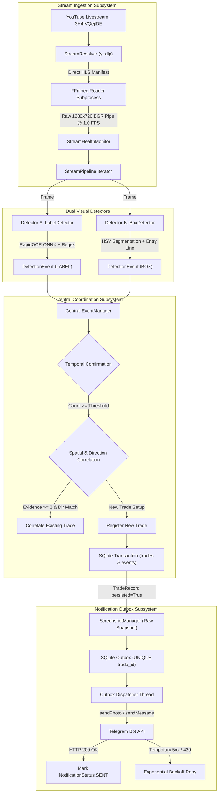

# Architecture & Subsystem Specification

This document details the architectural design, subsystem responsibilities, and data contracts of the Forex Trade Detection System.

---

## 1. System Architecture Diagram



---

## 2. Subsystems and Responsibilities

### 2.1 Stream Ingestion (`stream/`)
- **`StreamResolver`**: Uses `yt-dlp` to query live stream metadata. Extracts optimal 720p HLS manifests, caches stream URLs with expiration tracking, and detects stream offline/ended states.
- **`FFmpegFrameReader`**: Spawns an isolated FFmpeg subprocess that connects directly to the HLS URL, decodes video frames at 1.0 FPS, and writes raw BGR24 byte arrays to stdout.
- **`StreamHealthMonitor`**: Inspects each incoming frame for black frames (mean pixel value $\le 2.0$), frozen video (Mean Squared Error $\le 0.001$ over 30s), and dimension mismatches.
- **`StreamPipeline`**: Coordinates resolution, reader launch, health monitoring, and exponential reconnection backoff (5s to 60s).

### 2.2 Visual Detection Modules (`detectors/`)
- **`LabelDetector` (Detector A)**:
  - Crops frames to chart Region of Interest (ROI: `[0, 50, 1050, 620]`).
  - Runs local ONNX text recognition via RapidOCR (15–25ms CPU latency).
  - Matches candidate text against `BUY_PATTERN` (`BUY|LONG|8UY`) and `SELL_PATTERN` (`SELL|SHORT|5ELL`).
  - Filters out static chart text (`ZONE`, `SUPPLY`, `DEMAND`, `NEWS`, `PIPS`, `DAILY`).
  - Suppresses existing labels during startup baseline calibration ($N=10$ frames).
- **`BoxDetector` (Detector B)**:
  - Bipolar HSV color segmentation for green profit regions ($H \in [35, 85]$) and red loss regions ($H \in [0, 10] \cup [165, 180]$).
  - Contour filtering for valid trade boxes (area $\ge 400$, width $\ge 35$, aspect ratio $[0.25, 8.0]$).
  - Detects horizontal entry-line separator and verifies candle width parity ($\min(w)/\max(w) \ge 0.40$).
  - Supports multi-TP zones by clustering adjacent profit segments.

### 2.3 Central Event Manager (`core/event_manager.py`)
- **Confirmation Policy**: Requires candidate events to be observed across $N$ consecutive frames (default: 2 frames in production, 1 frame in low-latency mode) before activation.
- **Cross-Detector Correlation**:
  - **Direction Rule**: BUY and SELL events are strictly segregated and never merged.
  - **Multi-Factor Evidence**: Requires at least two independent structural pieces of evidence:
    1. Entry line alignment ($\Delta y \le 12\text{px}$).
    2. Horizontal origin candle alignment ($\Delta x \le 30\text{px}$).
    3. Bounding box intersection ($\text{IoU} \ge 0.40$).
    4. Centroid proximity ($\text{dist} \le 45\text{px}$).
- **Safe Persistence Retry Queue**: If an active trade fails to write to SQLite due to a temporary database lock, the activation is queued in `_pending_persist_trades` and retried every cycle until confirmed.

### 2.4 Notification Subsystem (`notifications/`)
- **Transactional Outbox**: An outbox record is inserted into SQLite with status `PENDING` and a `UNIQUE(trade_id)` constraint before network delivery is attempted.
- **Delivery Protocol**:
  - Checks for on-demand screenshot saved by `ScreenshotManager`.
  - Attempts multipart `sendPhoto` with caption `"TRADE IS ACTIVE!"`.
  - If photo upload fails, falls back immediately to `sendMessage` text alert.
  - Updates SQLite record to `SENT` on HTTP 200 OK.
- **Intelligent Error Handling**:
  - Permanent (HTTP 400, 401, 403, 404): Marked `FAILED` without retrying.
  - Temporary (HTTP 5xx, timeouts, 429 rate limit): Scheduled for retry with bounded exponential backoff ($\min(2.0 \times 2^{\text{retry}}, 60.0\text{s})$).

---

## 3. SQLite Database Schema & Relations

```sql
-- Trades: Master lifecycle records
CREATE TABLE IF NOT EXISTS trades (
    trade_id TEXT PRIMARY KEY,
    state TEXT NOT NULL,
    detector_source TEXT NOT NULL,
    first_detected_at TEXT NOT NULL,
    last_seen_at TEXT NOT NULL,
    bbox_x INTEGER NOT NULL,
    bbox_y INTEGER NOT NULL,
    bbox_width INTEGER NOT NULL,
    bbox_height INTEGER NOT NULL,
    notification_sent INTEGER NOT NULL DEFAULT 0,
    notification_sent_at TEXT,
    metadata_json TEXT NOT NULL DEFAULT '{}'
);

-- Events: Raw triggers from Detector A and Detector B
CREATE TABLE IF NOT EXISTS events (
    event_id TEXT PRIMARY KEY,
    trade_id TEXT,
    detector_type TEXT NOT NULL,
    signal_type TEXT NOT NULL,
    confidence REAL NOT NULL,
    timestamp TEXT NOT NULL,
    bbox_x INTEGER NOT NULL,
    bbox_y INTEGER NOT NULL,
    bbox_width INTEGER NOT NULL,
    bbox_height INTEGER NOT NULL,
    snapshot_path TEXT,
    raw_metadata_json TEXT NOT NULL DEFAULT '{}',
    FOREIGN KEY (trade_id) REFERENCES trades(trade_id) ON DELETE SET NULL
);

-- Notifications: Transactional outbox queue
CREATE TABLE IF NOT EXISTS notifications (
    notification_id TEXT PRIMARY KEY,
    trade_id TEXT NOT NULL UNIQUE,
    chat_id TEXT NOT NULL,
    message_text TEXT NOT NULL,
    photo_path TEXT,
    status TEXT NOT NULL,
    retry_count INTEGER NOT NULL DEFAULT 0,
    max_retries INTEGER NOT NULL DEFAULT 5,
    next_retry_at TEXT,
    last_error TEXT,
    created_at TEXT NOT NULL,
    updated_at TEXT NOT NULL,
    sent_at TEXT,
    FOREIGN KEY (trade_id) REFERENCES trades(trade_id) ON DELETE CASCADE
);
```

